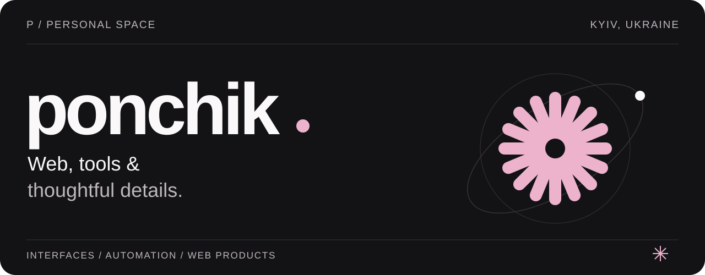

<picture>
  <source media="(prefers-color-scheme: dark)" srcset="./assets/profile-dark.svg" />
  <source media="(prefers-color-scheme: light)" srcset="./assets/profile-light.svg" />
  
</picture>

<h1 align="center">Привет, я Ponchik.</h1>

  Создаю сайты, веб-приложения и инструменты автоматизации. 
  Люблю понятные интерфейсы, аккуратный код и внимание к деталям.

  
  
  

 

## 01 / Сейчас в работе

Развиваю **[Zoovix](https://github.com/Ponchik0/Zoovix)** — каталог фильмов и сериалов с поиском, локализацией и PWA. Параллельно работаю над сайтами для локального бизнеса: меню, услуги и контакты в одном понятном интерфейсе.

Интересны задачи на стыке дизайна и разработки: от небольшой страницы до веб-продукта с интеграциями и автоматизацией.

 

## 02 / Избранные работы

| Проект | Коротко |
| :--- | :--- |
| **[Zoovix](https://github.com/Ponchik0/Zoovix)** | Кинокаталог с поиском и PWA. В разработке. |
| **[Portfolio](https://ponchik0.github.io/portfolio/)** | Мои проекты и кейсы на трёх языках. |
| **[Maksym Café](https://ponchik0.github.io/portfolio/uk/projects/maksym-cafe/)** | Меню и страница кафе — пилотный концепт. |
| **[Poezdato](https://ponchik0.github.io/portfolio/uk/projects/poezdato/)** | Поиск поездов и расписание — концепт редизайна. |

 

## 03 / Инструменты

| Направление | Стек |
| :--- | :--- |
| **Интерфейсы** | TypeScript · React · Next.js · Astro · Tailwind CSS |
| **Данные и API** | Node.js · Supabase / PostgreSQL · Redis · REST API |
| **Автоматизация** | Python · боты · интеграции с внешними сервисами |
| **Рабочий процесс** | Git · GitHub Actions · Docker · Vite |

 

## 04 / За кодом

<picture>
  <source media="(prefers-color-scheme: dark)" srcset="https://raw.githubusercontent.com/Ponchik0/Ponchik0/output/github-contribution-grid-snake-dark.svg" />
  <source media="(prefers-color-scheme: light)" srcset="https://raw.githubusercontent.com/Ponchik0/Ponchik0/output/github-contribution-grid-snake.svg" />
  
</picture>

Kyiv, Ukraine · Europe/Kyiv · Discord: @ponchikkk

 

<picture>
  <source media="(prefers-color-scheme: dark)" srcset="./assets/footer-dark.svg" />
  <source media="(prefers-color-scheme: light)" srcset="./assets/footer-light.svg" />
  
</picture>

  Обсудим сайт, интерфейс или автоматизацию? 
  <a href="https://t.me/bogdashkaq"><strong>Написать в Telegram ↗</strong></a> &nbsp;·&nbsp; <a href="mailto:regressphobia@outlook.com">regressphobia@outlook.com</a>

